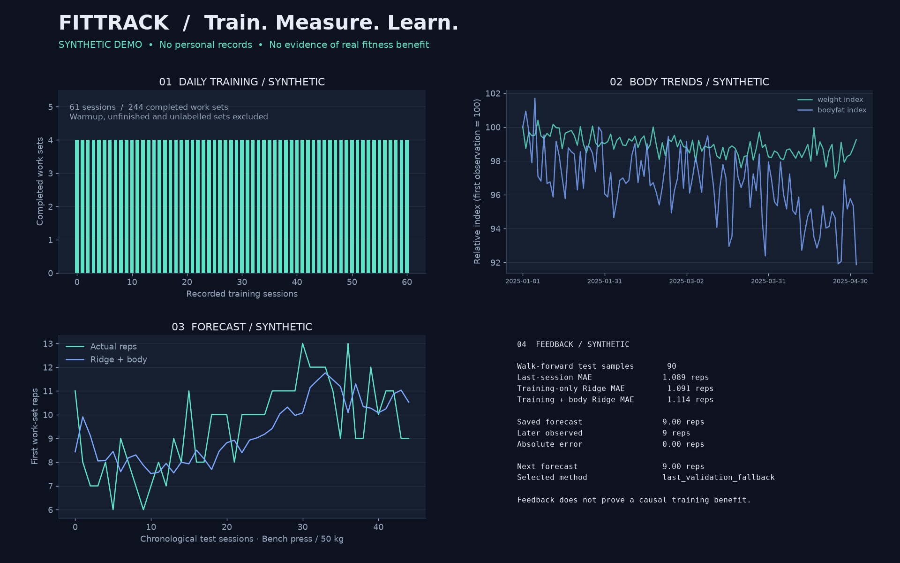
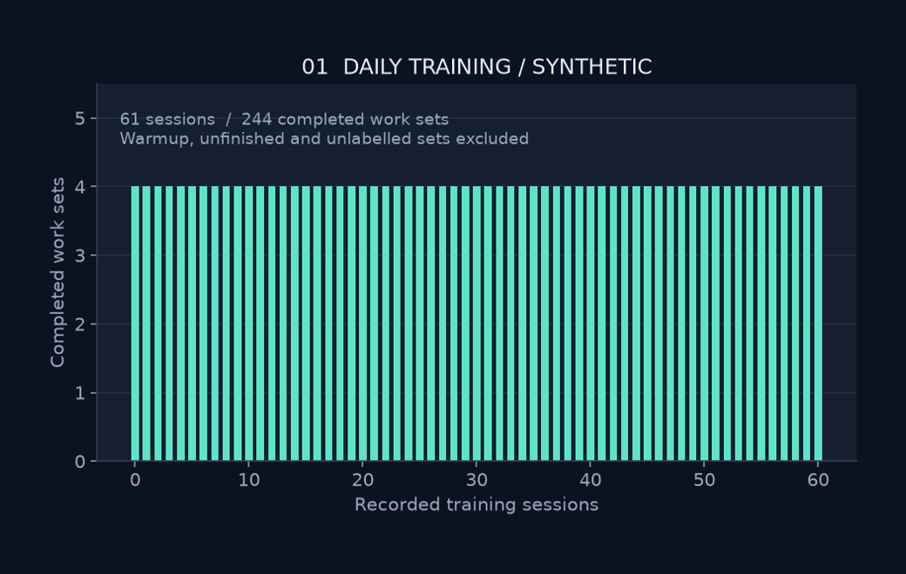

# FitTrack

**源于训记数据接入场景的训练与身体数据追踪工具，支持使用者填写自己的私有服务器 API。** 使用 Python 和 SQLite 整理每日记录，比较历史表现，开展可解释预测，并通过后续反馈辅助调整训练。

**公开演示全部使用虚构数据。** 当前结果验证的是软件流程；尚未完成真实用户预测效果或训练收益验证。项目独立开发，非训记官方产品。



## 解决什么问题

训练日志和身体测量往往分散，单次波动也难以说明训练是否有效。FitTrack 把两类记录连接起来，回答：过去练了什么、同一动作表现如何变化、下一次的预期是什么，以及建议之后实际发生了什么。

原始应用场景是把训记中的训练场次、动作、组记录和身体数据整合分析。公开版仅提供空白接口配置，由使用者自行填写私有服务器的训练与身体数据读取地址和凭证。服务器按约定返回规范化数据；第三方来源的接入与映射由使用者处理。详见 [填空配置与数据契约](docs/api.md)。

## 功能展示



| 功能 | 第一版实现 |
| --- | --- |
| 每日训练 | 按日期查询动作、重量、次数、组别及完成状态；正式完成量与热身、未完成组分开 |
| 身体数据 | 保存测量日期、可用时刻、指标和单位，展示历史趋势与缺失；不会把漏测记为零 |
| 模型预测 | 预测同动作、同器械、同重量下，下次首个正式工作组的完成次数 |
| 训练调整 | 将预测与上次表现连接到可解释的建议规则，输出维持或调整目标次数的建议 |
| 持续追踪 | 训练前保存预测，训练后记录实际次数与是否采纳，再用新记录生成后续预测 |

当前建议用于个人辅助判断。模型未优于基准时采用基准预测；数据不足时明确停止预测。图片 OCR、聊天助手和自动修改云端训练计划不包含在独立演示中。

## 五分钟运行

Python 3.11 或更新版本：

```bash
python -m venv .venv
# Windows PowerShell
.\.venv\Scripts\Activate.ps1
# macOS / Linux
# source .venv/bin/activate
python -m pip install -e .
fittrack demo
```

无需账号和凭证。命令会在 `outputs/demo/` 生成 SQLite 数据库、历史 JSON、评估报告、四张功能图、总览图和 GIF。演示会重建其专用的虚构数据库，以便重复运行；若检测到真实来源数据，会拒绝重建与导出。

```bash
# 查询演示中的训练与身体记录
fittrack --db outputs/demo/fittrack.sqlite3 history --source synthetic --start 2025-04-25 --end 2025-05-02

# 导入最小虚构示例到另一个数据库
fittrack --db outputs/example.sqlite3 import examples/minimal-synthetic.json --source synthetic

# 核心检查
python -m unittest discover -s tests -v
python scripts/check_public.py

# 重新生成 GitHub 展示图与评估材料（仅虚构数据）
fittrack demo --publish docs
```

需要真实接入时，填写自己的私有服务器地址和凭证，将数据库保存在被忽略的 `private/` 下。配置模板中的四个值全部留空，未填配置不会发出请求。详见 [接入说明](docs/api.md)。本仓库未执行真实账号请求。

## 数据处理与模型

```text
用户自填的私有服务器接口 / 规范化导入 / 虚构演示数据
                  ↓
日期与单位校验 → 事务写入 SQLite → 历史查询
                  ↓
筛选可比正式组 → 构建预测日前的历史特征
                  ↓
时间顺序评估 → 基准比较 → 预测与建议
                  ↓
保存实际反馈 → 导入后续训练 → 下一轮预测
```

SQLite 按场次、动作位置、组位置保存训练，按来源、日期、指标保存身体数据。重复导入更新原记录；整批数据校验失败时不会部分落库。未知器械与未知组别不能被推定为有效预测样本。

预测使用近期同动作次数、训练间隔和频次，以及预测日前七天的体重、体脂参考值。采用固定参数的 Ridge 回归，与上次表现、近三次均值比较，同时评估移除身体特征后的结果。每次只用更早记录训练，填补缺失和标准化也只在训练窗口拟合。方法依据见 [scikit-learn 时间顺序评估说明](https://scikit-learn.org/stable/modules/cross_validation.html#time-series-split)。

下一次预测的模型选择只参考过去的验证误差；若不足五次验证，或 Ridge 不优于上次表现，则使用上次表现基准。详细口径、样本要求与反馈流程见 [设计文档](docs/design.md)。

## 已有验证结果

固定种子生成的 120 天虚构记录包含 60 次训练、120 个可比动作场次、109 个身体测量日，11 天漏测。使用 90 次按时间顺序的单步预测评估：

| 方法 | 平均绝对误差，单位：次数 ↓ |
| --- | ---: |
| 沿用上次表现 | 1.0889 |
| 近三次均值 | 0.9630 |
| 仅训练特征的 Ridge | 1.0912 |
| 训练与身体特征的 Ridge | 1.1142 |

**这组演示中，近三次均值误差最低，身体特征没有改善 Ridge 的结果。** 当前保守选择规则比较 Ridge 与上次表现基准，演示中的下一次预测采用后者；选择规则仍有进一步比较近三次均值的空间。没有据此宣称机器学习优于简单方法。

反馈演示另外加入一次后续虚构训练：先保存预测，再导入实际记录、计算误差，最后生成新预测。它是历史顺序回放，不能视为真实前瞻试验。完整明细见 [评估报告](docs/evaluation.md)、[逐次预测 JSON](docs/evaluation.json) 与 [反馈记录](docs/feedback.json)。

本地已验证重复导入、事务回滚、单位换算、时间隔离、预测不可覆写、反馈记录、稀疏数据与接口异常等核心路径。GitHub Actions 对 Windows / Linux、Python 3.11 / 3.13 运行同一套检查；以仓库实际运行结果为准。

本地验证环境为 Windows、Python 3.14；依赖版本快照见 `requirements-tested.txt`。其他 Python 版本按 `pyproject.toml` 解析兼容依赖，快照不作为跨版本锁文件。

## 隐私与项目状态

公开仓库从新的 Git 历史开始，只包含代码、说明和虚构演示材料。真实身体图片、健康记录、饮食信息、个人授权、凭证和原始接口回执均不包含在内。发布前执行文件范围与凭证模式扫描，具体边界见 [隐私说明](docs/privacy.md)。

已实现数据流程、可运行演示、基础预测、历史评估和反馈持久化。真实 API 连通性、真实个人数据上的预测能力，以及建议对训练效果的影响，均待独立验证。当前版本不预测增肌量、减脂量或伤病风险。

## English overview

FitTrack is a Python/SQLite portfolio project for longitudinal training and body-metric tracking. Optional private-server endpoint and token settings are blank: users supply their own APIs implementing the documented normalized contract. No real provider addresses or credentials are included. It supports atomic imports, explicit missingness and set semantics, comparable-session forecasting, chronological evaluation with baselines and a body-feature ablation, immutable forecast snapshots, and an explicit feedback loop. The runnable public demo is entirely synthetic. Real API connectivity and real-world coaching efficacy are not validated by this release.
